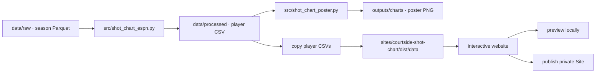

# Workflow: Courtside Shot Chart Lab

This guide covers the full path from season data to the local charts and the hosted interactive site.

## Data flow



## 1. Refresh the shot data

Run commands from the project root (`D:\mlbasket`). The ESPN script reads season-level Parquet files from `data/raw/`, downloads them if missing, and writes the configured players to `data/processed/`.

```powershell
python -m pip install -r requirements.txt
python src/shot_chart_espn.py
```

To inspect a SportsDataverse release and download its Parquet assets, use:

```powershell
python src/explore_shots.py
```

Before refreshing a new season, update `CONFIG` in `src/shot_chart_espn.py` and confirm the season-level file is available. Keep raw Parquet in `data/raw/` and player CSVs in `data/processed/`.

## 2. Regenerate the poster

```powershell
python src/shot_chart_poster.py
```

The image is written to `outputs/charts/shot_chart_poster.png`. The simpler chart script writes `outputs/charts/shot_charts.png`.

## 3. Update the website data

The static website reads CSV files from its own `dist/data/` directory. Copy refreshed player files there:

```powershell
Copy-Item data/processed/stephen_curry_2025.csv sites/courtside-shot-chart/dist/data/
Copy-Item data/processed/paige_bueckers_2025.csv sites/courtside-shot-chart/dist/data/
```

The site expects these columns: `LOC_X`, `LOC_Y`, `SHOT_DISTANCE`, `SHOT_MADE_FLAG`, `type_text`, and `score_value`. If adding a player, add their data file and update the player configuration and selector in `sites/courtside-shot-chart/dist/index.html`.

## 4. Preview locally

Serve the site over HTTP from the project root; opening `index.html` directly as a `file://` URL will prevent the browser from fetching its CSV files.

```powershell
python -m http.server 8000 --directory sites/courtside-shot-chart/dist
```

Open `http://localhost:8000`, then stop the server with `Ctrl+C` when finished.

## 5. Publish the website

The hosted Site is **private** and its identity is stored in `sites/courtside-shot-chart/.openai/hosting.json`. Keep that file and its `project_id`; do not create a second Site for this project.

When publishing through Codex, ask it to update and publish the existing **Courtside — Shot Chart Lab** Site. Codex should push the current source, package the `dist/` output, save the version, and deploy it privately. Site credentials are short-lived; pass them only through the Sites workflow and never commit or paste them into project files.
